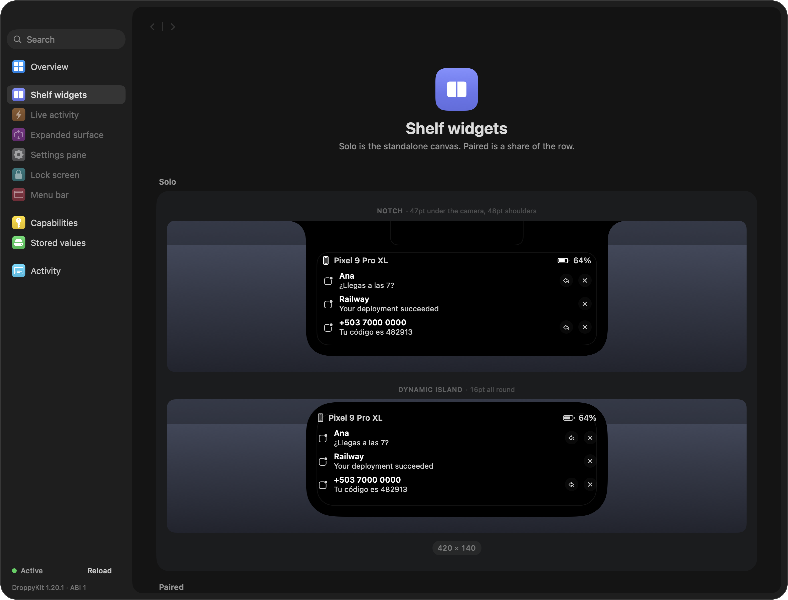
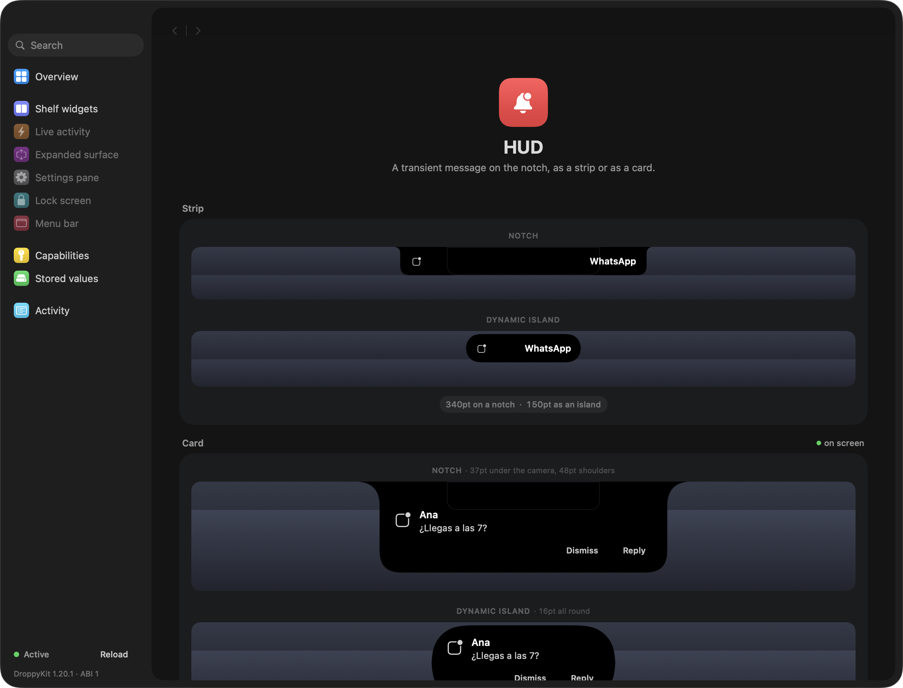

# Gossip for Droppy

Your Android phone in the notch. A [Droppy](https://getdroppy.app) droplet for
[**the Gossip fork**](https://github.com/JosueGalRe/gossip): it shows what
Gossip mirrors from your phone and lets you act on it without leaving what
you're doing.

<p align="center">


</p>

## What it does

- **Shelf widgets** for the phone (battery and the latest notifications), its
  media and its SMS conversations.
- **New notifications on the notch**, which you can reply to or dismiss right
  there. Each phone app can be switched to announce or stay quiet.
- **Media controls** for whatever the phone is playing.
- **Ring the phone**, and open Gossip's mirroring and pairing.
- The phone's battery on the **lock screen**, and a **Phone menu** in the
  menu bar.
- **Shortcuts:** "Ring my phone" and "Show phone messages" take a global
  shortcut in Droppy, and `droppy://droplet/gossip/ring`, `/mirror`,
  `/messages` and `/pair` work from Shortcuts, Raycast or a hotkey app.

## Requirements

- [Droppy](https://getdroppy.app) 15.3 or later.
- [The Gossip fork](https://github.com/JosueGalRe/gossip#getting-the-fork)
  running on the same Mac and paired with your Android phone. Upstream
  Gossip doesn't have the bridge this droplet talks to.

## Install

1. Download `Gossip.droplet.zip` from the
   [latest release](https://github.com/JosueGalRe/gossip-droplet/releases/latest)
   and unzip it.
2. In Droppy, open **Store → Local droplets** and drop `Gossip.droplet` there.
3. Droppy didn't sign this droplet, so it asks before running it, once per
   launch. **Don't ask again for local droplets** turns that off for every
   local droplet.

Droppy checks this repository's releases for updates when the droplet's
Settings page opens, or with **Check for updates** in its options menu.

## Developing

You need the [DroppyKit](https://getdroppy.app/docs/droppykit) CLI.

```bash
droppykit run        # open it in Droppy's Settings panel
droppykit build      # produce .build/Gossip.droplet
droppykit validate   # the checks the Store runs
swift test
```

`AGENTS.md` is the brief for coding agents, and `.mcp.json` /
`.cursor/mcp.json` connect the DroppyKit MCP server. Run `droppykit agent` to
point them at your DroppyKit checkout.

## Releasing

1. Bump `version` in `droplet.json` and add the entry to `CHANGELOG.md`.
2. Build from a clean checkout, so nothing uncommitted ends up in the bundle,
   and publish a release whose tag matches the version:

```bash
droppykit build
ditto -c -k --keepParent .build/Gossip.droplet Gossip.droplet.zip
shasum -a 256 Gossip.droplet.zip > Gossip.droplet.zip.sha256
gh release create v1.1.0 Gossip.droplet.zip Gossip.droplet.zip.sha256 --title 1.1.0
```

## License

[Apache 2.0](LICENSE)
